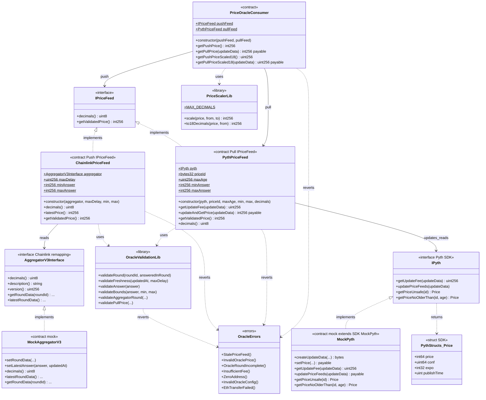

# Class diagram — Decentralized Oracles (Push / Pull)

> Versión en español: [diagrama-de-clases-ES.md](./diagrama-de-clases-ES.md)

Structural view of contracts, interfaces, and relationships (module 13, **final v1**).

## Diagram (Mermaid)

## Key relationships

| Relationship | Reason |
|----------|--------|
| `ChainlinkPriceFeed` → `AggregatorV3Interface` | Push pattern: the feed is already on-chain |
| `PythPriceFeed` → `IPyth` | Pull pattern: the caller brings the payload and pays the fee |
| Both → `OracleValidationLib` | Same staleness / bounds / answer policy |
| `PriceOracleConsumer` → feeds | Facade; view Push + payable Pull with exact fee and refund to the caller |
| `MockPyth` inherits the SDK | Full `IPyth`; helpers `createUpdateData` / `setPrice` |
| Remappings | Chainlink via `lib/`; Pyth via `node_modules/@pythnetwork/...` |

## Design decisions (v1)

- `IPriceFeed` only has `decimals` + `getValidatedPrice`; `latestPrice()` is an alias in `ChainlinkPriceFeed`.
- Bounds, `maxDelay` / `maxAge`, addresses: **immutable** (retune = redeploy).
- Scaling to 18 decimals only in the consumer (`getPushPriceScaled18` / `getPullPriceScaled18`).
- The consumer pays the **exact fee** to `PythPriceFeed` and refunds the excess to the original `msg.sender`.
