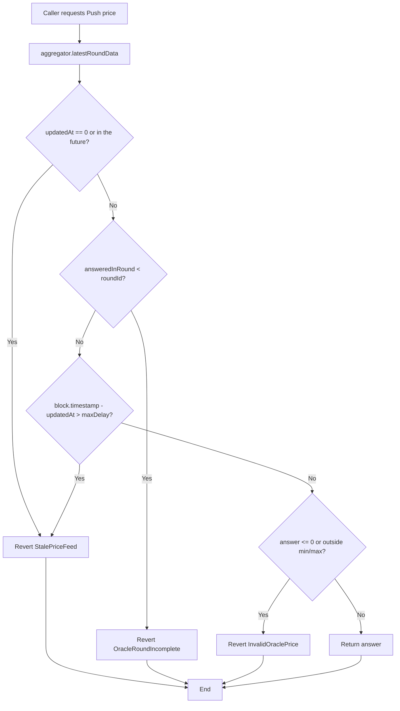
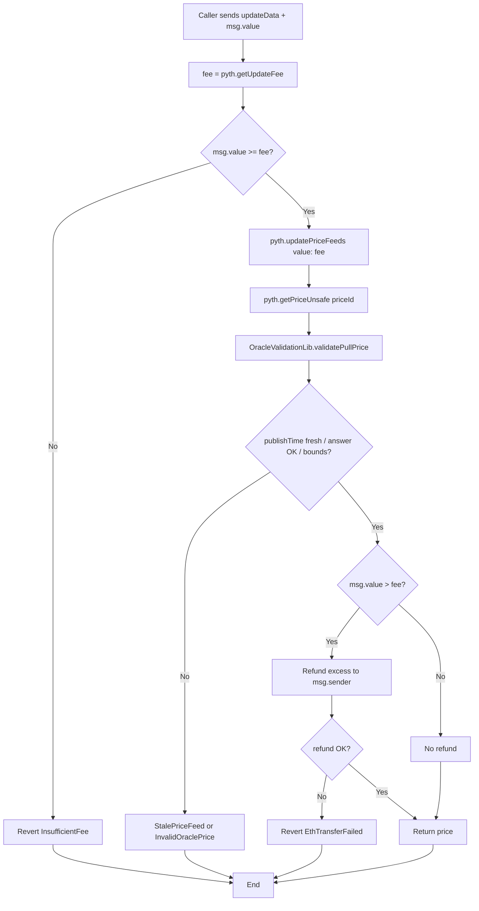
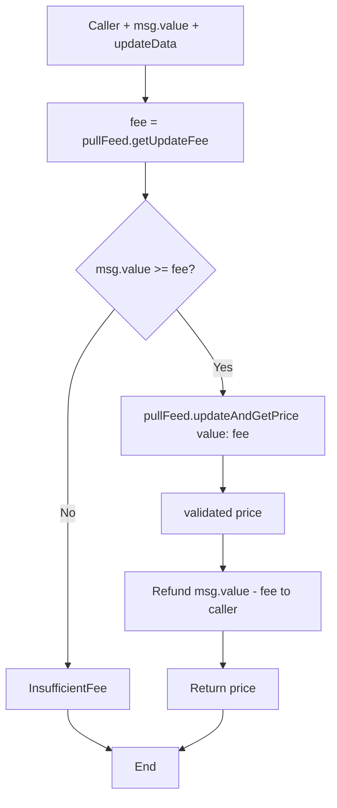
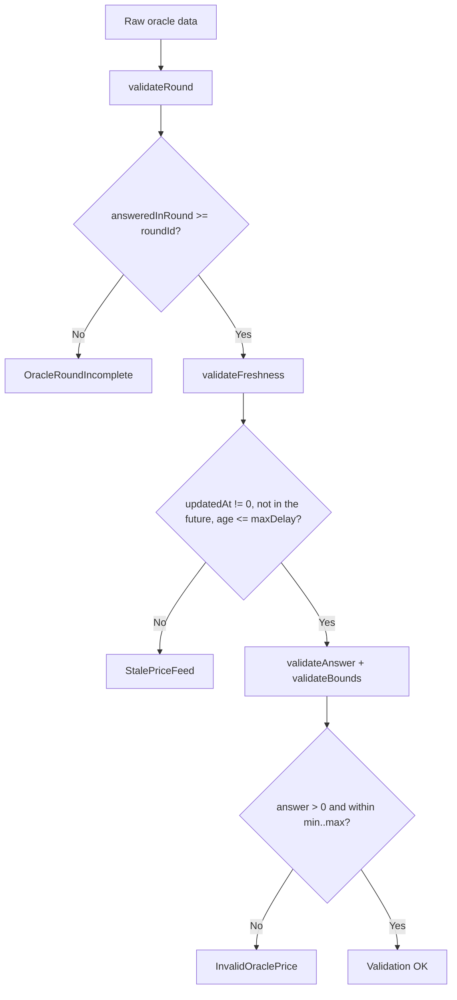
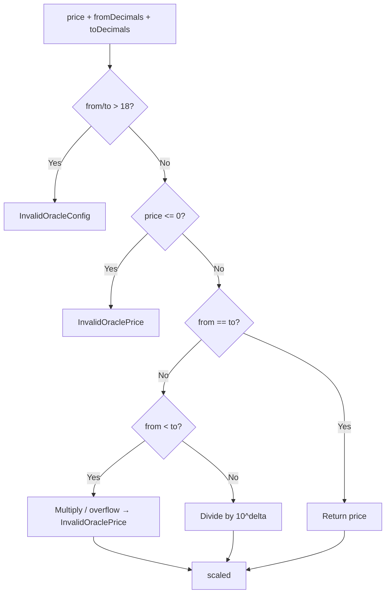
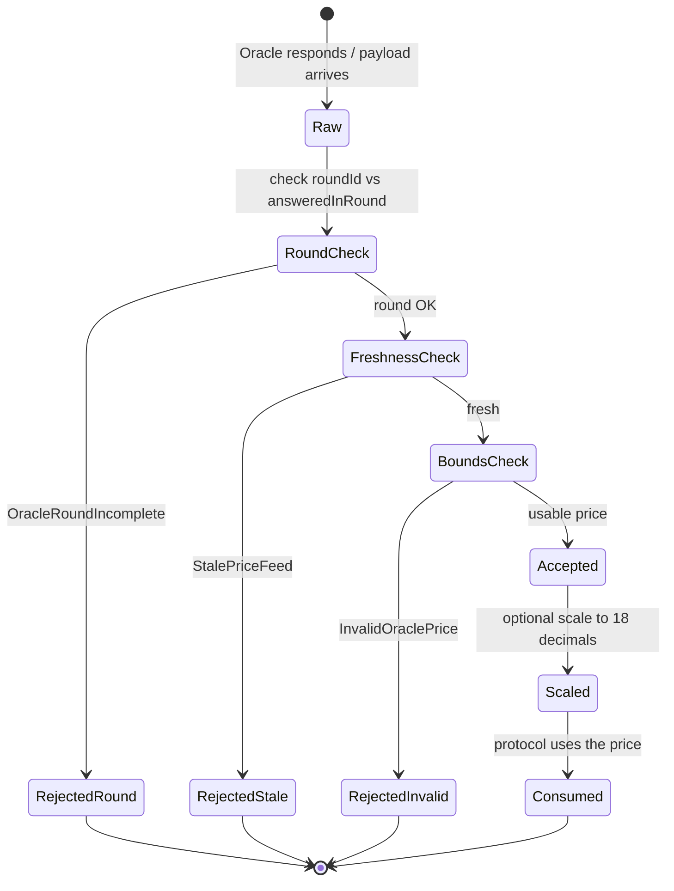
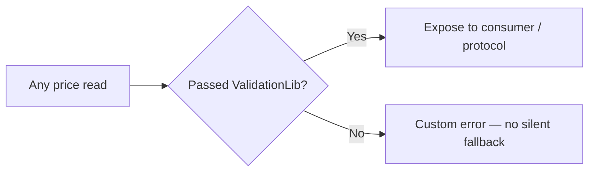

# Flow diagram — Push / Pull validation and price consumption

> Versión en español: [diagrama-de-flujo-ES.md](./diagrama-de-flujo-ES.md)

Internal decision flows of the oracle system (module 13, **final v1**).

## 1. Push read — `ChainlinkPriceFeed.getValidatedPrice`

## 2. Pull read — `PythPriceFeed.updateAndGetPrice`

## 3. Pull consumer — `PriceOracleConsumer.getPullPrice`

> The consumer sends the **exact fee** to the feed (the feed does not refund on that path) and refunds the remainder to the user.

## 4. Shared validation — `OracleValidationLib`

## 5. Decimal scaling — `PriceScalerLib`

## 6. State lifecycle — observed price

## 7. Cross-cutting rule — never trust a raw price

Applies to: Push `latestRoundData`, Pull after `updatePriceFeeds`, and consumer helpers.
