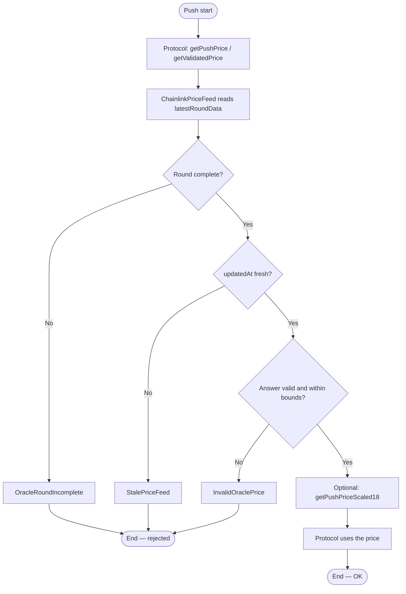
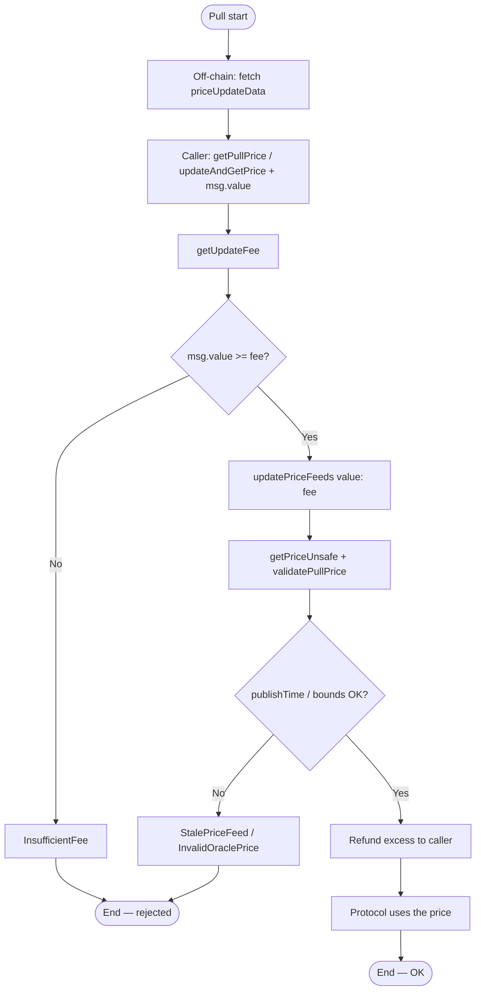
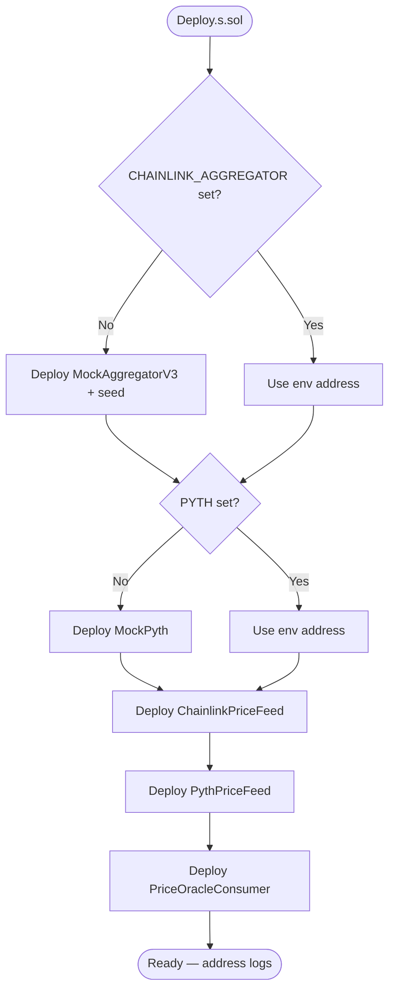
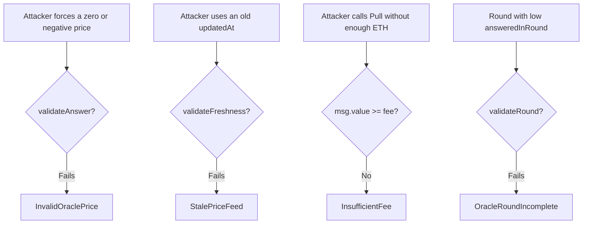
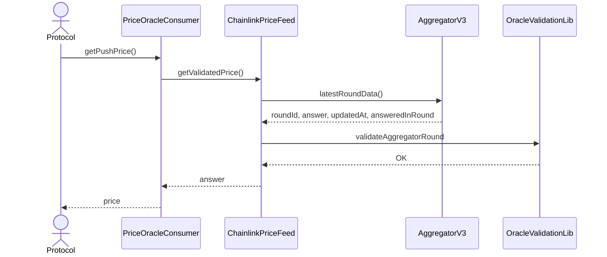
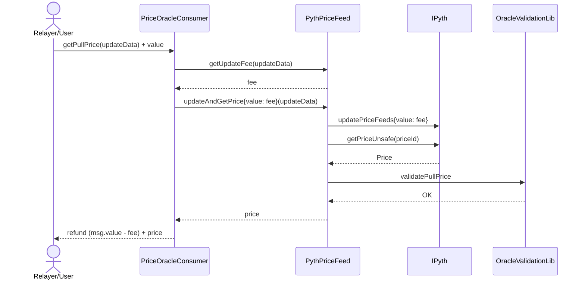
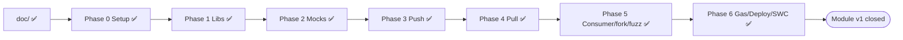

# Flowchart — Full Push (Chainlink) and Pull (Pyth) lifecycle

> Versión en español: [flujograma-ES.md](./flujograma-ES.md)

End-to-end flow between actors and contracts (module 13, **final v1**): Push read, Pull update, validation and consumption.

## Actors

| Actor | Role |
|-------|-----|
| Protocol / Consumer | Requests a safe price (Push or Pull) |
| Keeper / Relayer | In Chainlink, maintains the aggregator; in Pyth, supplies `priceUpdateData` |
| User / Tester | In tests: sets up mocks or runs a mainnet fork |
| AggregatorV3 (Chainlink) | Stores rounds on-chain (Push model) |
| Pyth (`IPyth`) | Verifies attestations and updates prices on demand (Pull model) |
| `ChainlinkPriceFeed` / `PythPriceFeed` | Wrappers with the module's validation |
| `PriceOracleConsumer` | Unified facade toward the protocol |
| CI / Foundry | Unit, fork, fuzz, gas |

---

## Main flowchart — Push (Chainlink)

---

## Main flowchart — Pull (Pyth)

---

## Flowchart — Deploy and wiring

**Documented mainnet reference:** ETH/USD Chainlink `0x5f4eC3Df9cbd43714FE2740f5E3616155c5b8419`

---

## Flowchart — Typical attacks / misuse

---

## Sequence — Push happy path

---

## Sequence — Pull happy path (via consumer)

---

## Implementation governance (v1 history)

All phases **0–6** were authorized and completed. Extensions: see `planificacion-EN.md` §12.
